# 🎵 Spindle — Offline Music Player

**Your music. Your style. Your control.**

Spindle is a feature-rich Android music player built around your local music library. It combines smart library scanning, powerful playback, playlist management, metadata editing, synchronized lyrics, and deep visual customization in one offline-first experience.

## 📱 Screenshots

  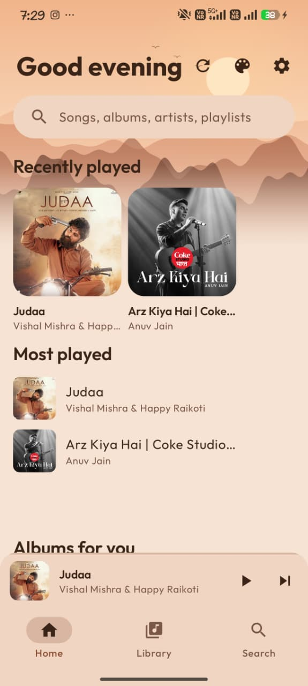
  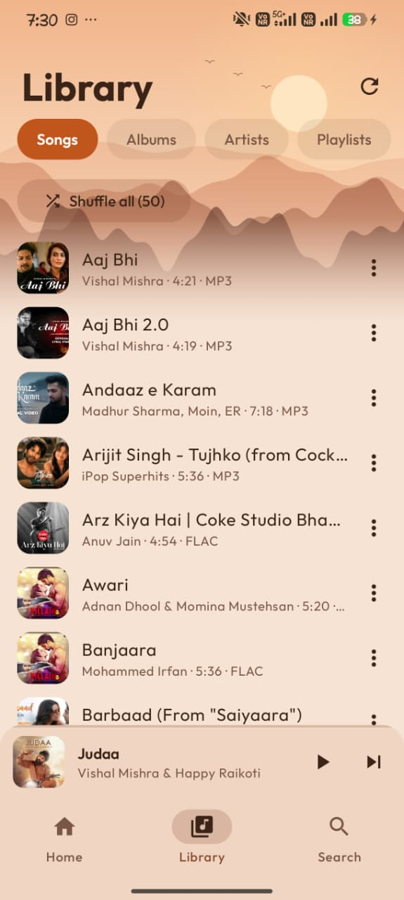
  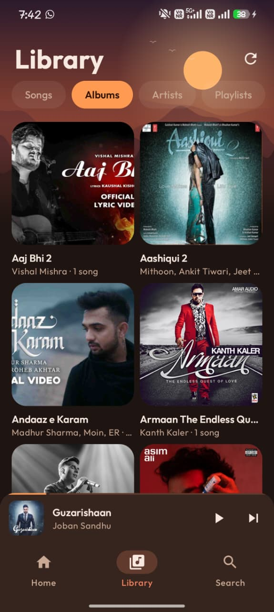

  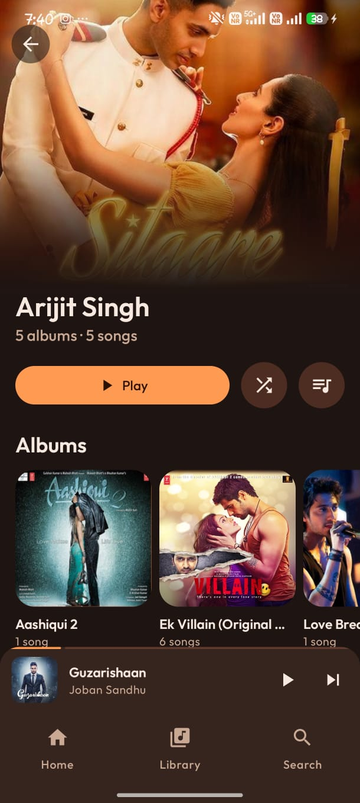
  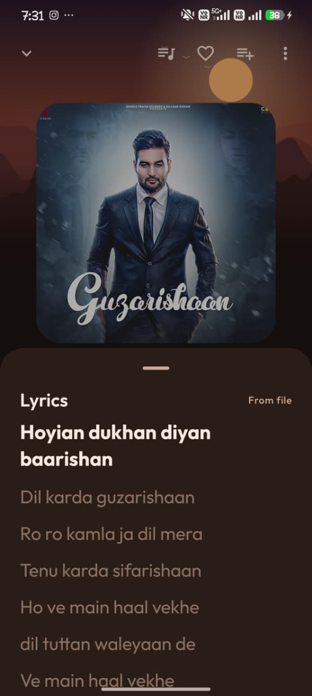
  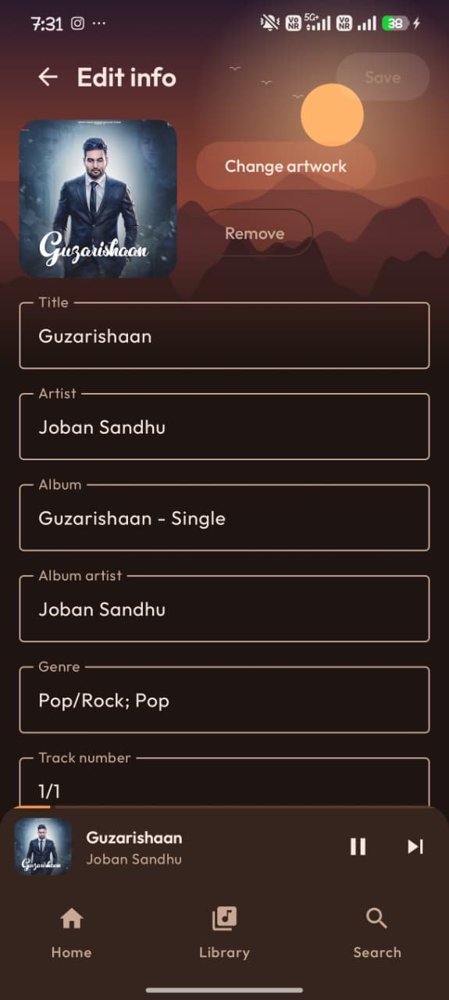

  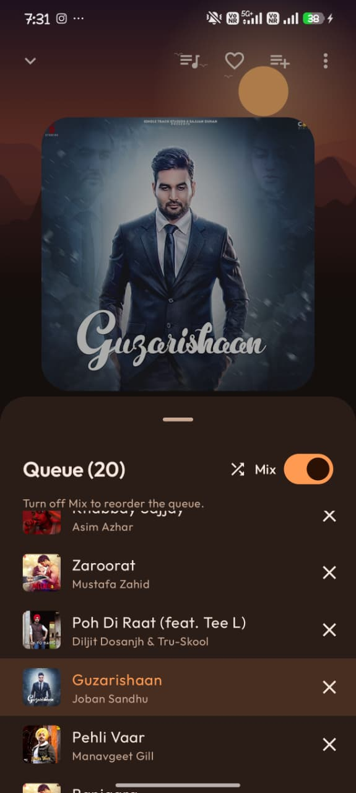
  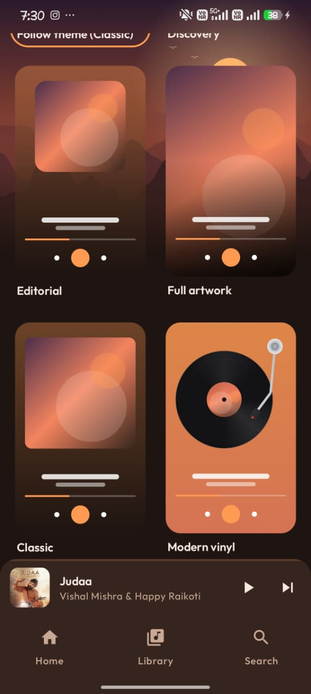
  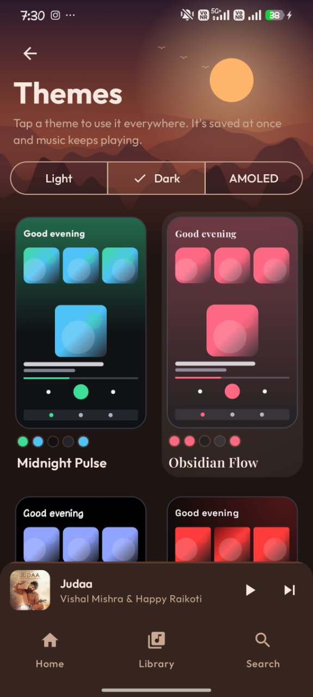

  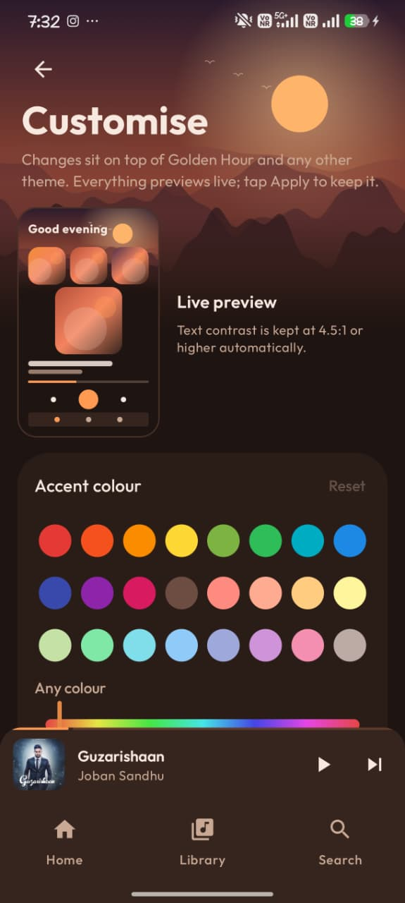
  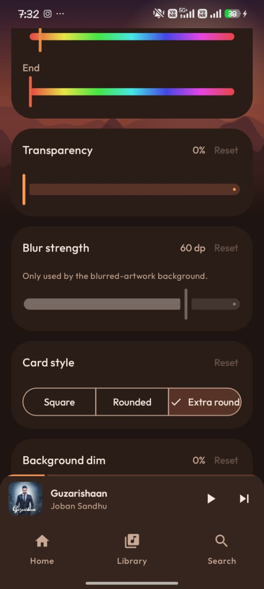
  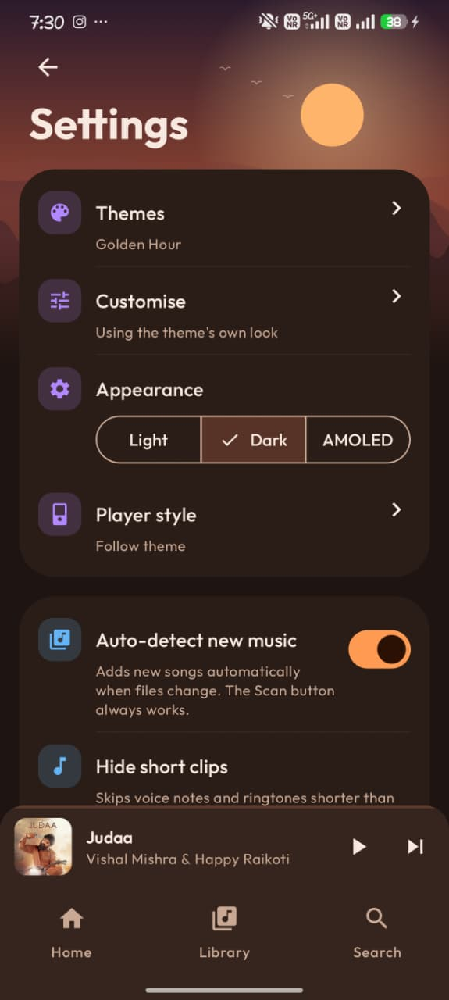

## ✨ Features

### 📚 Music Library
- Automatically detects music stored on your device, with a manual **Scan** option.
- Browse **Songs, Albums, Artists, and Playlists**.
- Dedicated artist pages and instant search across songs, albums, artists, and playlists.
- Hide short clips and voice notes using configurable **15s, 30s, or 60s** filters.

### 🎧 Playback
- Supports **MP3, FLAC, WAV, AAC/M4A, OGG, and Opus**, depending on device decoder support.
- Background playback with lock-screen and notification controls.
- Automatically pauses when earphones are disconnected.
- Shuffle, repeat (Off / All / One), playback speed (**0.5×–2×**), and independent pitch control.
- Queue management with drag-and-drop reordering, edge auto-scroll, remove, and Mix.
- Open audio files from file managers using **Open with Spindle**.
- Remembers the queue and playback position when reopening the app.
- Stop and close playback.
- Displays available codec, bitrate, and sample-rate information.

### 🎶 Playlists
- Create, rename, delete, and reorder playlists.
- Automatic Favourites collection.
- Recently Played, Most Played, and Albums for You.

### 🏷️ Metadata Editor
- Edit title, artist, album, genre, and track number.
- Add, crop, replace, or remove artwork.
- Display lyrics, including synchronized **LRC** lyrics with highlighted lines and tap-to-seek.
- Designed to edit metadata without re-encoding audio, with audio-byte verification after saving.

### 🎨 Themes & Customization
- **22 themes**, including Golden Hour and Crimson Ink.
- Light, Dark, and AMOLED appearance modes.
- **9 player styles:** Discovery, Classic, Editorial, Full Artwork, Modern Vinyl, Classic Vinyl, CD, Cassette, and Retro.
- **4 navigation styles:** Bottom Bar, Floating Pill, Top Tabs, and Retro Dock.
- Customize accent colours, backgrounds, gradients, transparency, blur, card style, dimming, and animation intensity.
- Persistent theme selection, live previews, contrast safeguards, and smooth transitions.

### ⚙️ Settings & Privacy
- Back up and restore settings, playlists, play counts, and lyrics.
- Clear error messages for missing, corrupted, or unsupported files.
- About page with developer photo and contact links.
- Bug-report email form with details pre-filled.
- Designed for offline listening: **no account, ads, tracking, or internet requirement for local playback**.

## 🚀 Installation

### Download
If an APK has been published, check the repository's [Releases](../../releases) page.

### Build from source
1. Clone this repository.
2. Open the project in Android Studio.
3. Allow Gradle to sync.
4. Build and run the app on a compatible Android device.

## 🛠️ Tech Stack

Update this section to match the project's actual implementation:
- **Platform:** Android
- **Language:** Add your language (for example, Kotlin or Java)
- **UI:** Add your UI framework
- **Audio engine:** Add your playback library

## 🐛 Bug Reports & Feedback

Found a bug or have a suggestion? Report it through the in-app bug-report feature or contact me on Instagram:

- [@himanshu_sharma_2321](https://instagram.com/himanshu_sharma_2321)

## 📄 License

Add a license file when you decide how others may use, modify, and distribute this project. Until a license is added, all rights remain with the copyright holder.

---

<b>Spindle — Your music. Your style. Your control.</b>

